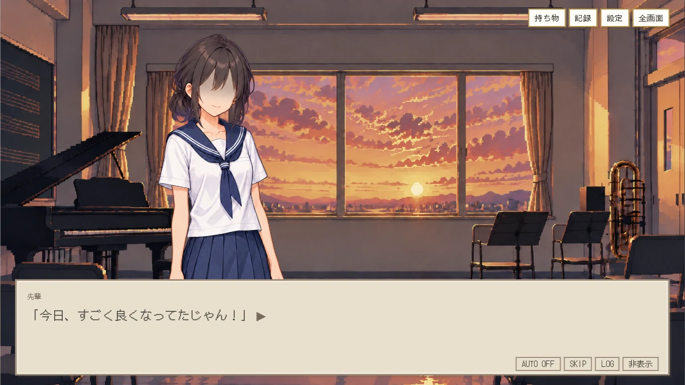
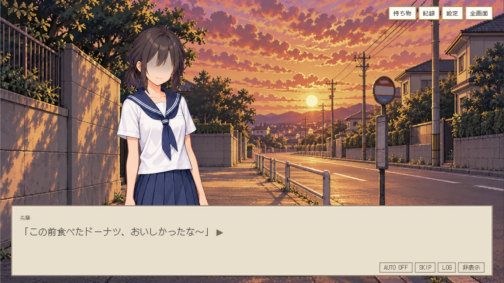
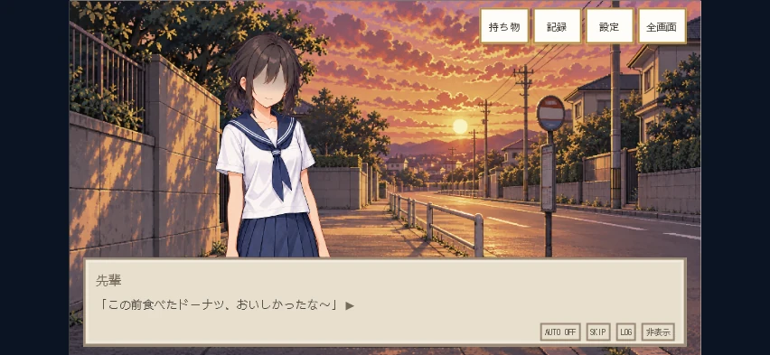

# 第1回想・背景＋立ち絵の採用版

2026-10-18 採用 / 確認用ブランチ `codex/room01-memory-novel` → 公開版 `main`

## 状態

第1回想を、背景＋会話中だけ立ち絵を表示するノベル形式で実装。前回承認済みの彼女は原画をそのまま使用。2026-10-18 17:43 JST、ユーザーが「1 このまま公開版へ反映」を選択し、音楽室・帰り道の新規背景2枚と確認版の構成を採用。公開版mainへ反映済み。

## 実装画面

音楽室で「今日、すごく良くなってたじゃん！」と話しかけられる場面。



練習後、バス停までの帰り道。「ドーナツ」「れんこんの南蛮漬け」の会話はここで進む。



スマホ横画面852×393相当（この記録の画像はChromium、Safari系WebKitはCIで確認）。



## 表示規則

- 音楽室・帰り道の導入と地の文は人物なしの背景のみ。
- 先輩と主人公の発言中は承認済みの彼女を表示。主人公の心の声では消す。
- 顧問・部長・部員の発言では彼女を表示しない。彼女がバスへ乗った後も立ち姿を残さない。
- 会話枠は色褪せたアイボリー、枠線は灰褐色。現在へ戻った直後に通常配色へ戻す。
- 原本の台詞・LOG ID・解答条件・回想後の解錠順序は保持。
- `room1_memory_03` は既存の回想後の発言「今のは……僕の記憶？」。名称だけで回想扱いしないよう修正。

## 素材

| 素材 | ファイル | 状態 |
| --- | --- | --- |
| 中学時代の彼女 | `images/characters/memories/room01/girl-approved.png` | 前回承認済み、原画変更なし |
| 人物のいない音楽室 | `images/background/memories/room01/music-room.png` | 2026-10-18承認済み |
| バス停までの帰り道 | `images/background/memories/room01/walk-home.png` | 2026-10-18承認済み |

## 検証

- 回想分類・実シナリオとの対応・会話送り・AUTO・SKIP・キャッシュ・シナリオ整合の関連単体26件成功。
- Chromiumの1366×768、852×393、667×375で、実際のピアノ正解入力→回想→本編復帰→解錠→保存後のロードを確認。
- 地の文・心の声・乗車後の非表示、背景切替、LOGと会話非表示からの復帰、場面中断時のレイヤー除去を確認。JSエラーと素材404なし。
- [CI 39112171384](https://github.com/bqlohakuto/saigononazo/actions/runs/39112171384) が成功。関連単体22件、PC Chromium 1366×768、Safari系WebKitの横画面852×393・667×375で上記の実操作を確認。iPhone実機は未確認。
- mainへの反映時は、配信ファイルと承認版の内容の一致を待ってから、同じブラウザ検証を公開URLに対して実行する。
- 公開コード `80d97f1fb3f55d612966cc9bd4a42ba9ec33724c` の [Pages公開](https://github.com/bqlohakuto/saigononazo/actions/runs/39112742641) と [公開URLでの第1回想検証](https://github.com/bqlohakuto/saigononazo/actions/runs/39112742878) が成功。PC Chromium／横向きWebKit 852×393・667×375でピアノ入力から本編復帰・セーブロードまで確認し、横画面の回想と復帰後の撮影も目視確認。オープニング・画像配信・第2/3/4/7・部屋選択の関連CIもすべて成功。

## 生成方法とプロンプト

組み込みimagegenを使用。人物を描かず背景だけを生成し、既存の承認済み立ち絵を別レイヤーで重ねる。入力参照は、実装済みの `images/pixel-ui/title-background-pixel.png`。原画PNGをそのまま保存し、表示時だけCSSで彩度を調整。以下が各最終プロンプト。

### 音楽室（既存タイトル背景から人物だけを除去）

```text
Use case: precise-object-edit. Asset type: a single full-frame 16:9 background plate for the Japanese pixel-art visual novel 最後の謎が解けるまで, first middle-school recollection. Reference image is the EXISTING APPROVED GAME TITLE BACKGROUND and is the edit target. Keep that exact music-room architecture, view, window framing, late-afternoon light, pixel resolution and restrained detailed pixel shading, piano on the left, and music chairs/stands. Change ONLY this: remove both people standing at the window, naturally reconstruct the window, floor and shadows behind them. The resulting music room must contain ZERO people, faces, body parts or silhouettes. It will receive a separately drawn girl sprite in the engine later. Make one continuous landscape background only, 16:9, no text, labels, title, borders, UI, montage, no additional objects. Preserve the established game's fine pixel style; no photo and no new art style.
```

### 帰り道（既存タイトル背景を画風参照として使用）

```text
Use case: illustration-story. Asset type: one 16:9 landscape background plate for a Japanese pixel-art visual novel, first middle-school recollection, AFTER school on the walk to the bus stop. The input image is STYLE REFERENCE ONLY: match its fine crisp pixel resolution, edge shapes, warm restrained palette, pixel-shaded materials, lighting and illustration quality; do not reproduce the music-room content. Scene: quiet ordinary Japanese residential roadside in summer around 2006, small simple round bus-stop marker beside the sidewalk near a low school boundary wall, a few unremarkable houses and summer greenery receding along a straight road; late-afternoon gentle warm light, nostalgic and slightly faded but still readable. Viewpoint of a middle-school student standing on the footpath. Continuous single scene; naturally clear foreground area near left center for a separately layered girl standing during dialogue, enough headroom and quiet uncluttered lower quarter for the dialogue window. Render only the minimum environment needed to communicate a walk home and bus stop. ZERO people, characters, faces, silhouettes, limbs, no vehicles currently in front of the viewer, no smartphones or modern billboards. No readable text, title, panel labels, captions, UI, frame, collage, watermark. No photorealism, no smooth 3D, no different drawing style. Single full-frame 16:9 background.
```
